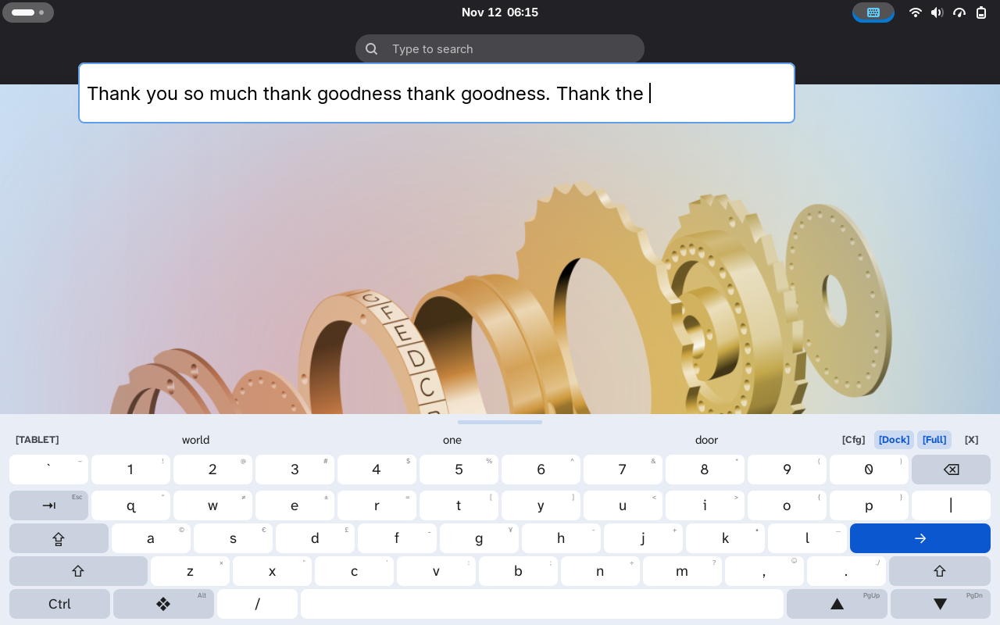
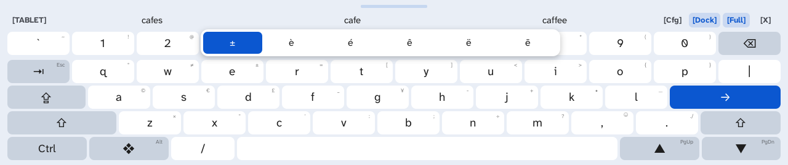
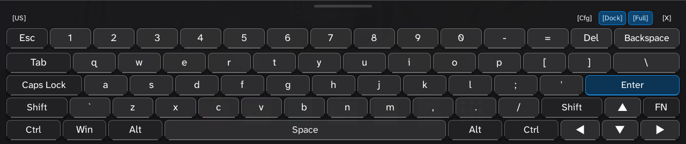
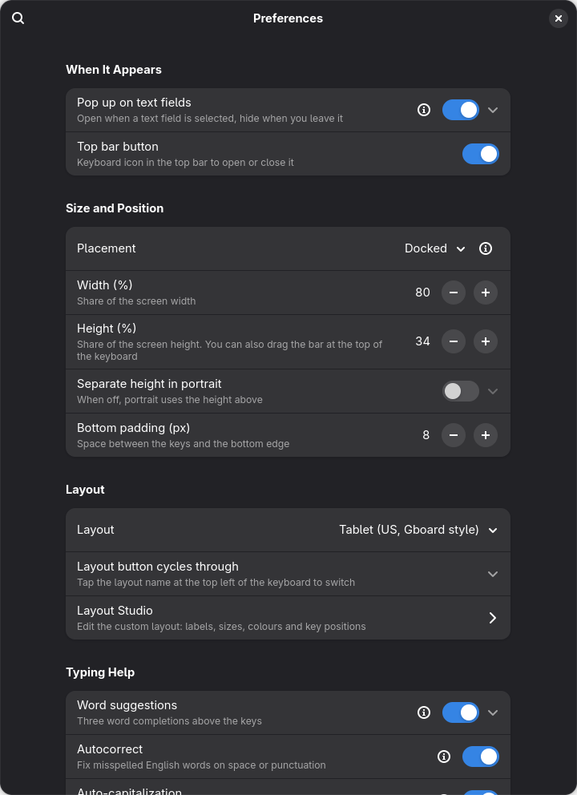
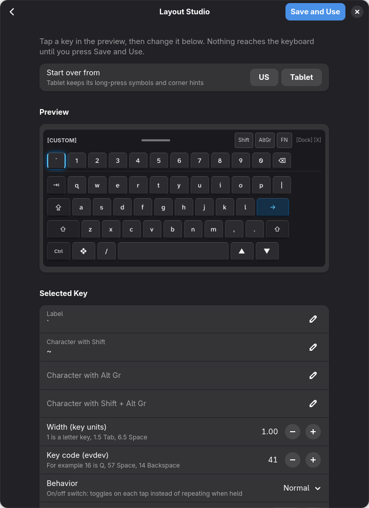

# Tabula OSK


*Tabula: Latin for a writing tablet. An on-screen keyboard for GNOME, built for touch devices.*

## The Problem
If you have ever used a modern Linux touch device running GNOME, you know the frustration: there is a severe lack of on-screen keyboard (OSK) extensions that work reliably, fluidly, and intuitively with touch gestures. The default options often feel clunky, sluggish, or poorly integrated into a modern mobile-first workflow.

## The Solution
Tabula OSK is an on-screen keyboard for GNOME Shell, made for touchscreen laptops and tablets and inspired by the Windows 11 touch keyboard.
It replaces the stock GNOME keyboard. It has a full TKL layout with real modifier keys, opens by itself when you tap a text field, suggests words,
and lets you move the cursor or select text by dragging on the keys.

Author: [BeShO-ShO](https://github.com/BeShO-ShO). Based on [**Fluent OSK**](https://github.com/TbangIT/fluent-osk) (`fluent-osk@tbang`) by [**TbangIT**](https://github.com/TbangIT). See [Credits](#credits).

Formerly **Apropos OSK** (`apropos-osk@besho-sho`); renamed to Tabula OSK in version 1.2.0.

## Screenshots

The Tablet layout (Material style), docked, with next-word suggestions in the header:


Hold a key for accents and symbols; slide to one and let go:


The US TKL layout in the Fluent style:


The settings window and the Layout Studio:
<p>


</p>

## Installation

Tabula OSK is not on extensions.gnome.org; it is installed from the GitHub releases.

**From a GitHub release** (recommended): download and install the latest release:
```bash
curl -LO https://github.com/BeShO-ShO/tabula-osk/releases/latest/download/tabula-osk@besho-sho.shell-extension.zip
gnome-extensions install --force tabula-osk@besho-sho.shell-extension.zip
```
(or download the zip by hand from the [Releases](https://github.com/BeShO-ShO/tabula-osk/releases) page).
Log out and back in (needed on Wayland), then enable it:
```bash
gnome-extensions enable tabula-osk@besho-sho
```
Settings: `gnome-extensions prefs tabula-osk@besho-sho`, or the Extensions app.

**Upgrading from Apropos OSK:** install Tabula OSK as above, log out and back in, and enable it. On its first start it
copies your settings, learned words and custom layout from Apropos OSK and turns the old extension off. Then remove the old
one with `gnome-extensions uninstall apropos-osk@besho-sho` (its `~/.config/apropos-osk/` folder can be deleted too).

**Updating:** run the same two commands again with the new release, then log out and back in. Your settings and
learned words are kept.

**Uninstalling:**
```bash
gnome-extensions uninstall tabula-osk@besho-sho
```
Learned words and a custom layout stay in `~/.config/tabula-osk/`; delete that folder to remove them too.

**From source:**
```bash
git clone https://github.com/BeShO-ShO/tabula-osk.git
cd tabula-osk && ./pack.sh
gnome-extensions install --force dist/tabula-osk@besho-sho.shell-extension.zip
```

**Requirements:** GNOME Shell 50 or 51. Autocorrect uses `enchant-2` and a Hunspell English dictionary (both installed by default on
Fedora Workstation). Optional: `ibus-typing-booster` for better word suggestions,
and the *Atkinson Hyperlegible Next* font for the default key labels. If that font is missing, the system font is used.

## Features

### Layout and keys
* **TKL layout:** Esc, a combined number/Fn row (F1 to F12), arrows, and all modifiers: Shift, Ctrl, Alt, AltGr, Super and Fn.
  Combinations such as `Ctrl+Alt+Del` and `Super+key` work.
* **Built-in layouts:** US (ANSI) and **Tablet (US, Gboard style)**: a touch layout
  laid out like Gboard's tablet keyboard: `` ` `` and the number row ending in `Backspace`; `Tab` (hold for `Esc`) and `|` (Shift for `\`) around the top letter row; `Caps Lock` and `Enter` (→) around the home row; `Shift` on both sides with `,` `.` beside `m` (hold `,` for the emoji chooser in GTK apps, hold `.` for `./` `../` `~/` `.com`); and `Ctrl` `❖` `/` `Space` `▲` `▼` at the bottom (slide on Space for Left/Right). Tap `❖` for Super, long-press it for a sticky `Alt` (tap it again to release). Long-press `▲`/`▼` for Page Up/Down (▼ starts on Page Down), or Shift+Page Up/Down to scroll a terminal's history.
* **Modifier behavior:** each key can work as a normal key (hold) or as an on/off switch (latch).
* **Modified-key highlight:** while Shift, AltGr or Fn is active, the keys that change symbol are colored. The colors can be changed.
* **Super key:** a tap opens the Activities overview, and holding it with another key sends the combination.
* **Key repeat:** every key repeats when held, with adjustable start delay and speed.
* **Sound feedback:** an optional soft click on each key press.

### Gestures
| Key | Gesture | Result |
| :--- | :--- | :--- |
| `Space` | drag left or right | moves the text cursor one character per step |
| `Backspace` | drag to the left | selects the text before the cursor, deletes it on release |

The sensitivity of both gestures can be set in pixels per character.

### Smart typing
* **Word suggestions:** shown in the top row of the keyboard, between the layout button and the Cfg/Dock/Width/Close buttons: three completions, the best one in the middle.
  The keyboard learns new words as you type. Learned words stay on your computer, in `~/.config/tabula-osk/`.
* **Next-word prediction:** after a space, or at the start of a sentence, the bar offers the likely next word. It learns the word pairs you type (stored only in `~/.config/tabula-osk/learned-pairs.json`), also uses the pairs Typing Booster has learned, and starts from a small built-in list.
* **Typing Booster mode:** suggestions can come from `ibus-typing-booster` instead, which sees the real text and shows six candidates.
  While the keyboard is open the input method switches to Typing Booster, and it switches back when the keyboard closes.
  It is not used in URL, e-mail, password, PIN, number or terminal fields, so browser address-bar completion keeps working.
  If Typing Booster is not installed, the built-in list is used.
* **Privacy:** nothing you type is logged. Password and PIN fields are never recorded and never show suggestions.
* **Long-press for accents and symbols (Tablet layout):** hold a key, slide to a character and let go. Each key shows its symbol
  in the corner, mostly as on Gboard (`e` → `|`, `t` → `[`, `m` → `?` …; no symbol appears twice, so anything a key already gives with Shift is left out and those keys offer `°` `≠` `±` `©` `€` `£` `¥` `•` `…` `×` `÷` instead; `?` stays on `m` as on Gboard), followed by the accented letters from GNOME's own keyboard data (`e` → `è é ê ë ē`).
  Double-tap Shift for Caps Lock.
* **Auto-capitalization:** Shift turns on by itself at the start of a sentence and in an empty field. It only affects letters,
  so Enter stays Enter and digits stay digits. Tap Shift to type a small letter instead.
* **Double-space period:** tapping space twice after a word types `. `.
* **Autocorrect (English):** misspelled words are fixed when you type a space or punctuation (`teh` → `the`, `dont` → `don't`, `i` → `I`).
  The system spell checker (Enchant with Hunspell dictionaries) decides what is misspelled; a word-frequency list picks the
  most likely fix, and only fixes the spell checker accepts are used. Nothing is changed when the fix is unclear.
  Press Backspace right after a correction to undo it; that word is then never corrected again.
  Not used in password, PIN, terminal, URL, e-mail or number fields, and off when the system language is not English.
* **Auto-pairing:** `()`, `[]`, `{}` and quotes are closed automatically with the cursor in between. Typing the closing character
  out of habit steps over it instead of adding a second one.

### Showing and hiding
* **Opens automatically** when a text field gets focus and closes when you leave it. The stock GNOME keyboard is blocked while this is on.
* **Touch only (optional):** opens automatically only when you tapped the field with a finger or pen, not when you got there with the mouse, touchpad or keyboard.
* **Hide on hardware key (optional):** an automatically opened keyboard closes as soon as you type on a physical keyboard, such as a Type Cover.
* **System dialogs:** in system pop-ups such as password prompts, the stock GNOME keyboard is used, because those dialogs block other keyboards.
* **Lock screen:** it also works on the lock screen, so you can type your password there.
* **Manual toggle:** from a top bar button (can be hidden) or a Quick Settings tile.

### Position and size
* **Docked:** fixed to the bottom of the screen. Drag the small tinted bar at the top centre of the keyboard to change its height.
* **Floating:** a free window you can drag anywhere.
* **Full width (strut mode):** covers the whole bottom of the screen and pushes windows up so no text field is hidden.
  Keys can stay at normal width, centered.
* Width and height as a percentage of the screen, with an optional separate height for portrait orientation. The height can also be set by dragging the bar at the top of the docked keyboard.
* Header buttons to switch layout and mode, open the settings, and close the keyboard. The layout button cycles only through the layouts switched on under *Layout button cycles through* in the settings.

### Appearance
* Two key styles: **Fluent** (Windows 11 look) and **Material** (flat phone look that follows the system light/dark style).
* Adjustable corner radius.
* Separate horizontal and vertical key gaps, an extra gap below the number row, and padding from the bottom edge.
* Font: *Atkinson Hyperlegible Next* when it is installed (otherwise the system font), or any installed font picked from a font chooser, with a text size setting.
  Labels shrink only when they do not fit in the key.

### Layout editor
The settings window has a visual editor for a custom layout (*Layout → Layout Studio*):
* An interactive preview. Click a key to edit it.
* For each key: its label, its Shift, AltGr and Shift+AltGr characters, its width, its Linux keycode, its color, and whether it is a normal key or a switch.
* Add or remove keys (a deleted key can be brought back with *Undo*) and move keys between rows.
* Start over from the US or Tablet layout. Starting from Tablet keeps its long-press symbols and corner hints. If there are unsaved changes, it asks first.
* *Save and Use* applies the layout live, with no restart. The custom layout is stored in `~/.config/tabula-osk/`.

## Changes from Fluent OSK

Tabula OSK started from [Fluent OSK](https://github.com/TbangIT/fluent-osk), which already had the TKL layout, the dock, floating and full-width modes, key repeat,
the Space and Backspace gestures, auto-pairing, the font and spacing settings and the layout editor. Tabula OSK adds:
* automatic showing and hiding on text fields, with the touch-only and hide-on-hardware-key options
* blocking of the stock GNOME keyboard, and using it on purpose in system dialogs
* word suggestions with word learning, and the Typing Booster mode
* the Quick Settings tile
* the small tinted bar at the top to resize the docked keyboard, and a separate height for portrait orientation
* a new name, UUID and settings schema, so it can be installed next to the original

## Known issues

None known right now. Bug reports and feature requests are welcome in [Issues](https://github.com/BeShO-ShO/tabula-osk/issues),
but I can't promise to implement every request.

Parts of this extension were written with the help of AI tools. I follow the GNOME version I use myself, so only the current
GNOME Shell release is supported. Help with reviewing and maintaining the code is very welcome.

## Credits

* [**TbangIT**](https://github.com/TbangIT): author of [Fluent OSK](https://github.com/TbangIT/fluent-osk) (`fluent-osk@tbang`), the extension this project is based on.
* [**BeShO-ShO**](https://github.com/BeShO-ShO): Tabula OSK modifications and maintenance.
* `words-freq-en.txt` is derived from [FrequencyWords](https://github.com/hermitdave/FrequencyWords) by Hermit Dave
  (OpenSubtitles 2018 word counts), licensed [CC BY-SA 4.0](https://creativecommons.org/licenses/by-sa/4.0/).
  Changes: lowercased, offensive words removed using the
  [LDNOOBW list](https://github.com/LDNOOBW/List-of-Dirty-Naughty-Obscene-and-Otherwise-Bad-Words) (CC BY 4.0), split contractions
  rebuilt, top 40,000 words kept. The derived list is also available under CC BY-SA 4.0.
* `next-words-en.txt` (next-word prediction) holds word pairs counted from the English sentences of
  [Tatoeba](https://tatoeba.org), licensed [CC BY 2.0 FR](https://creativecommons.org/licenses/by/2.0/fr/).
  Changes: only the 3,000 most common previous words and their 6 most common next words kept, limited to the
  `words-freq-en.txt` vocabulary (so offensive words stay out), names dropped, a few entries hand-picked.
* Long-press accents are read at runtime from GNOME Shell's own on-screen keyboard layouts (GPL-2.0-or-later); nothing is copied.

## License

[GNU General Public License v3.0](LICENSE). Fluent OSK was released under the same license.
Changes made in Tabula OSK are also released under GPLv3.
